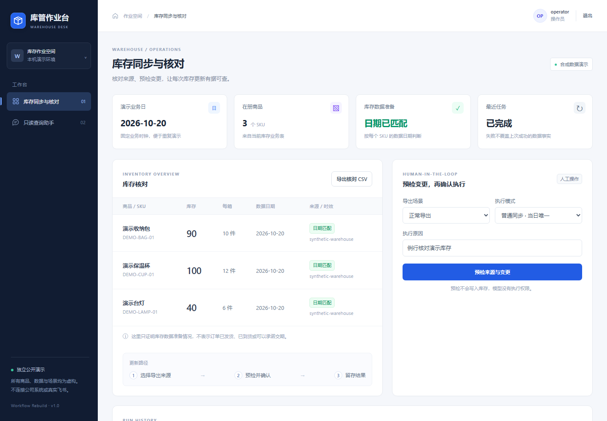

# 电商库管作业链重构 · Warehouse Workflow Rebuild

把一批库存导出数据变成**有日期、有校验、有执行记录的业务事实**，让运营查得明白，让失败可以人工恢复。

这是从实习工程经验中抽象、独立重设计的公开作品。代码、表结构、商品和导出数据均为本仓库的合成演示实现，不包含公司源码、业务模板、内部部署资料或真实数据；它不证明公司线上系统的运行效果。



## 一个具体问题

操作员准备核对当天库存。外部导出如果为空、日期过期或数量异常，系统不能把它当成“库存为零”覆盖业务表。失败也不能被一句“请求成功”掩盖。

本例先运行空导出，得到 **FAILED + 库存不变**；操作员查明原因后重新预检正常数据，以 **RETRY** 追加任务；保温杯库存从 80 更新到 100，数据日期更新为演示业务日，同时保留原失败和重试来源。

```text
虚构导出 → Java 预检（日期/覆盖/重复/数量/参考样本）→ 查看变更
        → 操作员明确确认 → 执行时复查来源摘要与业务版本
        → 成功：快照 + 审计 + 结果同一事务提交
        → 失败：业务数据不变，失败记录保留，由人工核对后重试

查询助手 → 规则命令 / 可选模型 → 只读工具 → Java 鉴权并查询实际数据
```

## 已实现的业务能力

- 六种合成导出场景：正常、空数据、过期、重复 SKU、总量异常、导出失败。
- 有效期5分钟、绑定用户/业务日/来源摘要/业务版本的预检结果；确认时再次校验。
- 普通任务当日唯一；失败重试与人工刷新追加记录，记录来源任务与操作原因。
- 持久化任务与快照；启动时把未收口任务标记为中断失败，不自动重试。
- 库存显示数据日期和来源；分别显示最近任务与最近成功，避免失败覆盖业务事实。
- Java 与 Python 两侧只读工具白名单；`viewer` 可查，`operator` 才能确认同步。
- Vue 工作台、实际库存核对 CSV、规则查询与可选真实模型的5轮工具循环。
- 可选定时入口使用普通任务键；不携带重试/刷新语义，默认关闭。

## 本地运行

需要 Java 21、Maven 3.9+、Python 3.12+、Node.js 20+。不需要 MySQL、Docker、飞书账号或模型 Key。

```powershell
git clone https://github.com/fengyue-xve/warehouse-workflow-rebuild.git
cd warehouse-workflow-rebuild
python -m venv .venv
.\.venv\Scripts\Activate.ps1
python -m pip install -r fastapi-service/requirements.txt
cd web-app
npm ci
npm run build
cd ../java-app
mvn package
cd ..
powershell -NoProfile -ExecutionPolicy Bypass -File scripts/start.ps1
```

打开 [本地工作台](http://127.0.0.1:18080)。账号 `operator` / `viewer`，本地演示口令均为 `demo-only`。演示业务日固定为 `2026-10-20`；页面展示的是合成快照，不是真实当天库存。

停止：`powershell -File scripts/stop.ps1`。数据库保存在 `runtime/warehouse.mv.db`；停止或重新构建不会清空数据。若希望重新演示初始状态，可以停止后改用一个新的 `DEMO_DB_URL` 文件路径，无需删除已有数据。

Linux/macOS 使用两个终端（先完成同样的依赖安装与构建）：

```bash
# 终端一，仓库根目录
cd fastapi-service
python -m uvicorn app.main:app --host 127.0.0.1 --port 18081
```

```bash
# 终端二，仓库根目录
java -jar java-app/target/warehouse-workflow-1.0.0.jar
```

启动脚本只启动本仓库服务，不部署或调用公司系统。默认绑定回环地址，演示账号和示例签名配置仅供本机合成数据体验。

## 三分钟演示

1. 使用 `operator` 登录；看到旧数据日期、保温杯80件和“需要更新”。
2. 选择“空导出”，预检会说明拒写原因。勾选后运行拒写场景：任务失败、库存仍为80。
3. 点击该任务“核对后重试”，对正常导出重新预检：保温杯80→100，收纳包120→90。
4. 确认执行：新任务成功，原失败仍在；重试记录可以追到原任务。
5. 切换查询助手，输入 `查询库存 DEMO-CUP-01` 或 `数据就绪`，核对工具返回的日期、来源与数量。

已经存在当日普通任务时，请从任务记录选择人工刷新或失败重试；不要再次用普通模式触发。

## 验证

依赖安装后，从仓库根运行：

```bash
python -X utf8 scripts/verify.py
```

它执行 Python 测试、前端构建、Java 测试/打包，以及真实双服务 HTTP 验收。HTTP 验收使用独立端口和数据库，包含停止 Python、保持 Java 查询可用，以及 Java 重启后数据保留。

可选浏览器验收（会操作正在运行的本机演示数据）：

```bash
python -m pip install playwright==1.62.0
python -m playwright install chromium
python -X utf8 scripts/browser_smoke.py
```

详细结果与范围见 [验收记录](docs/04-verification.md)。GitHub Actions 使用同一验证入口。

## 启用可选真实模型

在启动 Python 的终端设置自己的 `LLM_API_KEY`，可选设置 `LLM_BASE_URL`（默认 `https://api.deepseek.com`）与 `LLM_MODEL`（默认 `deepseek-chat`），然后启动服务。应用不会自动读取 `.env`；变量说明见 [.env.example](.env.example)。

固定命令始终先走规则，不消耗模型调用。其他问题在有 Key 时进入真实模型循环；模型只看到4个只读工具，每个工具3秒超时、每次模型请求30秒、最多5轮/每轮最多4个工具。缺 Key、模型失败或超出预算会明确降级。没有取得工具证据的自由回答不作为库存结论展示。

本次交付没有使用真实模型 Key；测试证明调用协议和权限边界，不代表真实模型回答质量。完整请求总时长还包含工具与网络耗时，5轮不是严格165秒总预算，Java代理另有超时上限。

## 技术与范围

Java 21 / Spring Boot 3 / JDBC / JWT；FastAPI / HTTPX；Vue 3 / Vite；H2 文件数据库用于免安装演示。MySQL是实习背景中的技术，本公开版本没有冒充已验证的MySQL路径。

本地事务覆盖本仓库 H2 写入，**不等于对外部协作表提供事务回滚**。这里也没有订单预留、采购收货、物流或对外消息发送。CSV 是库存核对表，不是实际装箱或发货凭据。

- [业务定义与边界](docs/01-business-flow.md)
- [接口、状态与权限](docs/02-contract.md)
- [从业务理解代码 / 面试讲解](docs/03-learning-guide.md)
- [验收与限制](docs/04-verification.md)
- [实现来源与贡献边界](docs/05-provenance.md)

代码借助 AI 协作完成。MIT License。

界面布局参考与本轮视觉验收见 [界面说明](docs/06-interface-design.md)。
