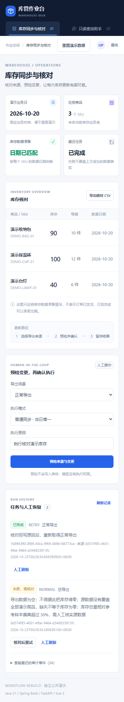
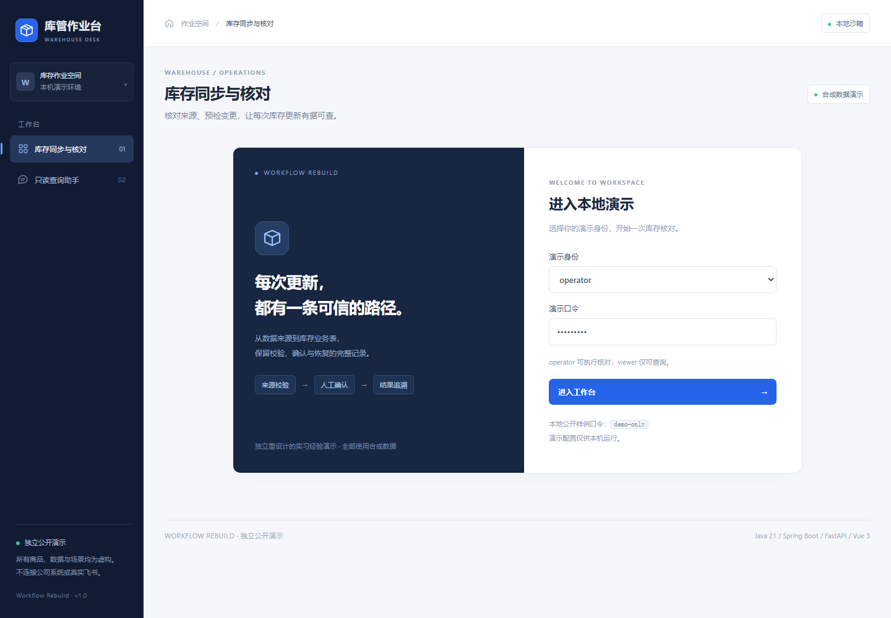

# Warehouse Workflow Rebuild

## 1. 项目定位与核心架构

Warehouse Workflow Rebuild 将库存采集、库管问答、敏感意图预检、人工确认和确定性写入组织成一条可追踪的库存作业链路。Java 主服务负责身份、任务状态和业务数据写入，Python 服务承接采集与 Agent 编排，Vue 3 工作台提供人工核验入口。

~~~mermaid
flowchart LR
  U[库管消息] --> R[FastAPI 双层路由]
  R -->|固定规则| T[只读工具]
  R -->|自然语言| L[最多 5 轮 Function Calling]
  R -->|敏感写意图| P[Java 只读预检]
  P --> C[差异摘要 / SHA-256 / 5 分钟凭证]
  C --> W[Vue 工作台人工确认]
  W --> J[Java 状态机与事务]
  J --> DB[(业务数据库)]
  X[采集与文件生成] --> J
~~~

本仓库采用 MIT License，根目录 <code>LICENSE</code> 和原始版权声明保持不变。

## 2. 核心 AI Agent 与受控工程特性

- **规则优先，模型兜底**：高频库存、商品、任务和就绪命令直接路由到只读工具；规则命中不调用模型。未命中的开放问题才进入最多 5 轮 Function Calling。
- **敏感写意图拦截**：同步库存、更新库存、重跑等写意图在模型循环之外进入只读预检，模型工具白名单不包含写接口。
- **凭证卡片联动**：预检返回变更明细、业务 <code>revision</code>、来源 SHA-256 摘要和 5 分钟绑定凭证；operator 可带入确认区，viewer 只读摘要。
- **确定性执行**：Java 服务端在执行时复核角色、来源摘要、业务版本、人工确认和幂等任务键，三态任务状态机保留失败与恢复记录。
- **数据与运行事实分离**：库存快照、最近任务和最近成功任务分别展示；旧数据、缺失 SKU、失败任务不会被自然语言推断覆盖。
- **重置演示基线**：工作台顶部一键恢复库存、任务与参考样本基线，同时递增业务版本并使旧预检凭证失效。

## 3. 工作台界面截图

## 4. 核心源码导航

| 能力 | 核心源码 |
| --- | --- |
| FastAPI Agent 路由、工具 Schema 与 Function Calling | [fastapi-service/app/main.py](fastapi-service/app/main.py) |
| Java API、角色边界与预检入口 | [java-app/src/main/java/dev/portfolio/warehouse/Api.java](java-app/src/main/java/dev/portfolio/warehouse/Api.java) |
| 预检摘要、SHA-256、状态机、事务与重置 | [java-app/src/main/java/dev/portfolio/warehouse/Workflow.java](java-app/src/main/java/dev/portfolio/warehouse/Workflow.java) |
| 会话 JWT、operator/viewer 权限 | [java-app/src/main/java/dev/portfolio/warehouse/Auth.java](java-app/src/main/java/dev/portfolio/warehouse/Auth.java) |
| Python ↔ Java 只读工具桥 | [java-app/src/main/java/dev/portfolio/warehouse/ExportGateway.java](java-app/src/main/java/dev/portfolio/warehouse/ExportGateway.java) |
| Vue 3 工作台与预检带入 | [web-app/src/App.vue](web-app/src/App.vue) |
| 数据表、唯一任务键与审计模型 | [java-app/src/main/resources/schema.sql](java-app/src/main/resources/schema.sql) |
| 跨服务回归与浏览器验收 | [scripts/verify.py](scripts/verify.py)、[scripts/e2e.py](scripts/e2e.py)、[scripts/agent-upgrade-browser.py](scripts/agent-upgrade-browser.py) |

## 5. 本地快速启动与自动化验证命令

~~~powershell
python -m venv .venv
.\\.venv\\Scripts\\Activate.ps1
pip install -r fastapi-service/requirements.txt
npm --prefix web-app ci
npm --prefix web-app run build
mvn -f java-app/pom.xml package
.\\scripts\\start.ps1
~~~

~~~powershell
python scripts/check_public.py
python scripts/verify.py
python scripts/browser_smoke.py
python scripts/agent-upgrade-browser.py
.\\scripts\\stop.ps1
~~~

服务启动后访问 <code>http://127.0.0.1:18080</code>，使用工作台的 operator/viewer 角色体验确认与只读链路。完整设计见 [docs/architecture.md](docs/architecture.md)。
